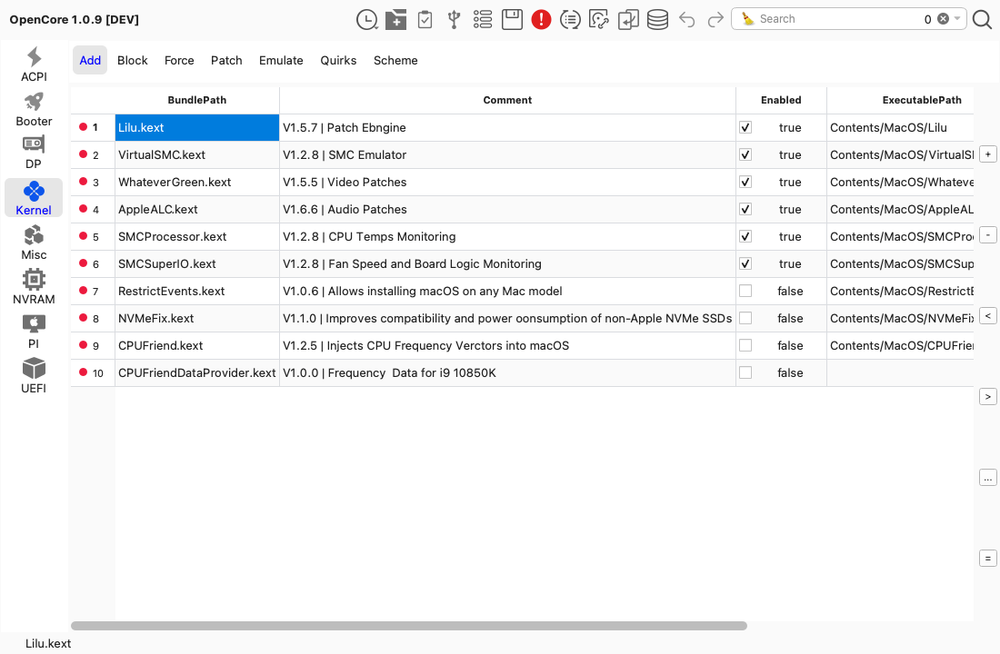
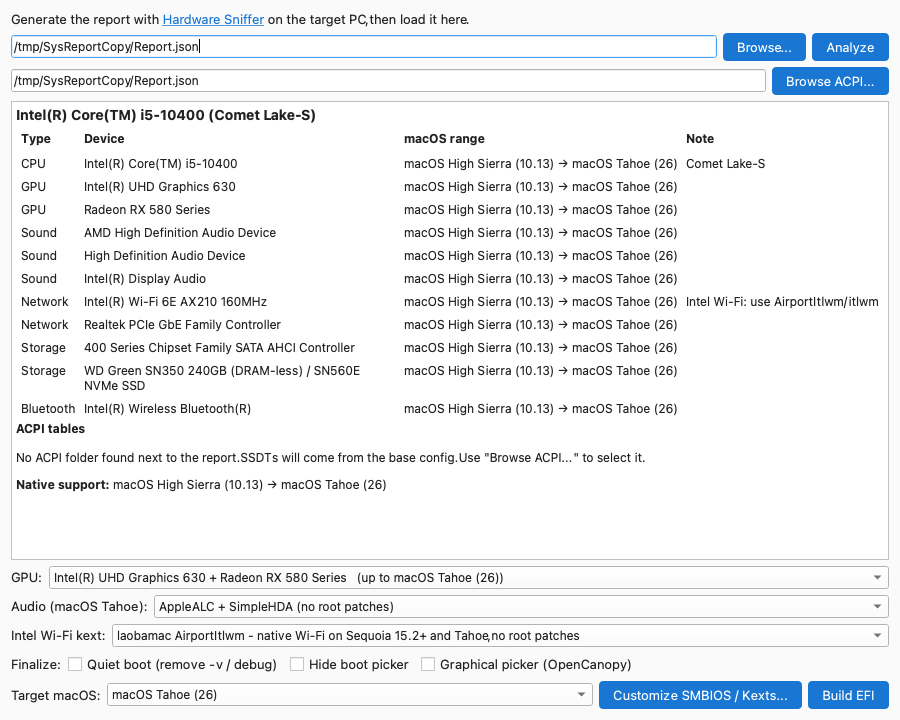
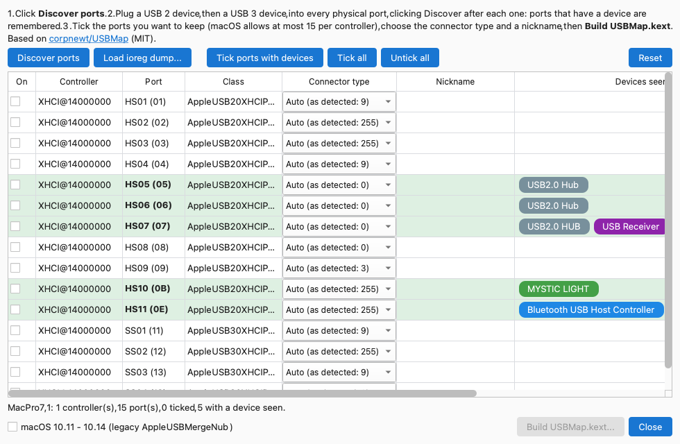
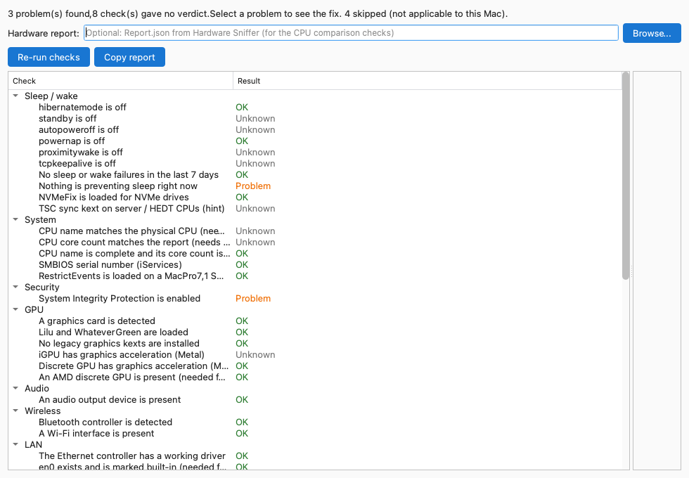

# OpenCore Auxiliary Tools (OCAT) — extended fork



A cross-platform (macOS / Windows / Linux) Qt GUI editor for OpenCore `config.plist`, with an **EFI Builder**, **USB Mapping**, a **Post-Install Check**, a Material theme and switchable icon sets added on top of the original app.

> This is a fork of [ic005k/OCAuxiliaryTools](https://github.com/ic005k/OCAuxiliaryTools). The original app and its features are the work of its author and contributors; the additions below are listed separately so it is clear what is new. See [Credits](#credits).

## About

OpenCore Auxiliary Tools is a GUI-based configurator for editing `config.plist` files for Acidanthera's OpenCore boot manager.

Unlike other configurators, OCAT doesn't break the config when the OpenCore developers add new features or keys to the config structure. It adapts and shows them in the interface automatically.

## What is new in this fork

Everything here is off to the side of the original editor: open it from the **Tools** menu or the toolbar.

### EFI Builder (Tools > EFI Builder)



Builds a ready-to-use EFI from a [Hardware Sniffer](https://github.com/lzhoang2801/Hardware-Sniffer) `Report.json`. The rules and datasets are ported from [OpCore Simplify](https://github.com/lzhoang2801/OpCore-Simplify).

* Checks each device for macOS compatibility and shows the macOS versions your hardware supports.
* Picks the base config, SMBIOS model, kexts and boot-args for your hardware, then uses the app's Generate EFI.
* **GPU selection**: with several GPUs, choose a valid combination (APU, Navi 22 and others are kept apart to avoid kext conflicts); unpicked GPUs are disabled with `disable-gpu`.
* **Audio**: pick the codec layout (`layout-id` or `alcid=`). On macOS 26 Tahoe choose **AppleALC + SimpleHDA** (no root patches) or **AppleALC + OpenCore Legacy Patcher**.
* **Intel Wi-Fi**: choose laobamac AirportItlwm, AirportItlwm or itlwm. AirportItlwm on macOS 15 / 26 also adds the OCLP root-patch requirements.
* Adds UTBDefault (with USBToolBox), NVMeFix and the Atheros Wi-Fi kexts where OpCore Simplify does.
* Reads the ACPI folder dumped next to `Report.json` and chooses matching SSDTs (PLUG, EC/USBX, AWAC-DISABLE, RTC0, PMC and more).
* Downloads the chosen kexts automatically (Dortania build repo, direct URL, GitHub releases, including pre-release-only repos), using the proxy and token from Preferences.
* Removes unused ACPI and kext rows from the generated config and EFI.
* **Finalize** options (all off by default): quiet boot, hide the boot picker, graphical picker (OpenCanopy).
* **Next steps** window after a build: the post-install tasks that apply (USB map, iServices, audio, power, sleep, security), each linked to the Dortania guide.

Not ported yet: SSDTs that OpCore Simplify generates with `iasl` (battery, XOSI, HPET and similar), Wi-Fi profile extraction, AMD vanilla kernel patches, iGPU framebuffer patching.

### USB Mapping (Tools > USB Mapping)



A native C++/Qt port of [USBMap](https://github.com/corpnewt/USBMap) by CorpNewt, so no Python or Terminal is needed.

* **Discover ports** reads `ioreg` and lists each USB controller and port with its class, connector type and plugged-in devices. Ports with a device are remembered across runs.
* Tick the ports to keep (a warning appears above macOS's 15-port limit), choose a connector type and give each port a nickname.
* **Build USBMap.kext** writes the kext (`AppleUSBHostMergeProperties`, or the legacy `AppleUSBMergeNub` for macOS 10.11 - 10.14). Choices are saved to `~/.ocat/USBMap/map.json`. **Load ioreg dump** works from a saved dump on any OS.
* The generated `Info.plist` was compared with USBMap's own output on the same data and is identical.

Not included yet: adding the kext to `EFI/OC/Kexts` and `config.plist` for you.

### Post-Install Check (Tools > Post-Install Check, macOS only)



Inspects the running Hackintosh against the [Dortania post-install guide](https://dortania.github.io/OpenCore-Post-Install/) and lists what needs attention.

* Sleep and wake, power management, SIP, GPU acceleration, audio, USB, NVMe, LAN, Wi-Fi, Bluetooth, keyboard and trackpad, hardware video decoding, CPU power management, iServices and more. Windows dual-boot time sync is checked too.
* Each failing check explains why it matters and gives the fix, with **Copy** and **Run in Terminal**. Commands that need no admin rights get **Run here**; admin commands get **Run (asks for password)**, which asks you to confirm first.
* A **Skipped** result for checks that do not apply. **Copy report** puts the results on the clipboard for forum help.
* Optionally compares a Hardware Sniffer `Report.json` with what macOS reports (CPU name and core count).

### Themes and icons
* **Material design theme** with light and dark variants (Preferences > Material design / Dark theme), applied live.
* **Icon sets** (Preferences > Icon set, applies after a restart): **Classic**, or **Material Symbols** SVGs tinted at runtime to match the theme.

### Other changes
* Semantic versioning (`MAJOR.MINOR.PATCH`); the update check compares versions numerically. See [CHANGELOG.md](CHANGELOG.md).
* Performance: the green/red file-status marking no longer leaks a widget per kext row.

## Features of the original app

Besides being a plist configurator it can do much more:

* Mount the EFI partition and automatically open the `config.plist`
* Update and migrate configs to the latest specs by clicking "Save". No more copying keys and validating the config by hand.
* Automatic config validation (ocvalidate) that points to possible conflicts and configuration issues.
* Sync: check for and apply updates for OpenCore, Resources and kexts with a few clicks
* Choose between Official / Dev releases and Debug builds of OpenCore
* Drop-down menus with suggested quirks for Intel and AMD CPUs
* Preset menus for ACPI, Kernel and other lists
* Editable list of kext repository URLs
* Integrated ASCII < > HEX converter
* Database with complete base configs for Intel and AMD CPUs based on Dortania's OpenCore Install Guide
* Generate EFI folders from a config with one click
* Create EFI folder backups

## Build

Qt 5 (tested with 5.15.2), including the **Qt SVG** module, and a C++11 compiler.

```
mkdir build && cd build
qmake ../OCAuxiliaryTools.pro CONFIG+=release
make -j8
```

## Guides

* [Updating OpenCore and Kexts with OCAT (by 5T33Z0)](https://github.com/5T33Z0/OC-Little-Translated/blob/main/Content/D_Updating_OpenCore/README.md)
* Pre-selected plug-in content for Intel CPU Quirks is provided and maintained by 5T33Z0. [Details](https://github.com/5T33Z0/OC-Little-Translated/tree/main/Content/F_Desktop_EFIs/preset)
* Intel CPU BaseConfigs plug-in package provided and maintained by 5T33Z0. [Details](https://github.com/5T33Z0/OC-Little-Translated/tree/main/Content/F_Desktop_EFIs)
* [OpenCore Auxiliary Tools User's Guide (by chriswayg)](https://chriswayg.gitbook.io/opencore-visual-beginners-guide/oc_auxiliary_tools)

## About adapt OpenCore version  （关于OCAT支持的OpenCore版本的问题）
[#311](https://github.com/ic005k/OCAuxiliaryTools/issues/311) [#361](https://github.com/ic005k/OCAuxiliaryTools/issues/361)

OCAT is Smart adapt to openCore version,if you need update  openCore version，you can get new OpenCore like this 
（OCAT 是智能适应OC的新版本的，如果你需要更新OC版本,你可以按照下图操作）

First,  click this button （第一步，点击这个按钮）


Second, select the latest version or the other version from the drop-down list（第二步，在下拉列表里选择最新的版本或者其他的OC版本）


Third, click to get the latest version, or get the OC version of your choice（第三步，点击获取最新版，或者获取你选择的OC版本）


## Credits

### This fork's additions build on
* **[OpCore Simplify](https://github.com/lzhoang2801/OpCore-Simplify)** by [lzhoang2801](https://github.com/lzhoang2801) (BSD-3-Clause): the EFI Builder's compatibility rules, kext selection logic, GPU / audio / Wi-Fi choices and datasets are ported from it. Licence: [`src/efibuilder/LICENSE-OpCore-Simplify.txt`](src/efibuilder/LICENSE-OpCore-Simplify.txt). The [Hardware Sniffer](https://github.com/lzhoang2801/Hardware-Sniffer) report format comes from the same author.
* **[USBMap](https://github.com/corpnewt/USBMap)** by [CorpNewt](https://github.com/corpnewt) (MIT): the USB Mapping window is a C++ port of its logic. Licence: [`src/usbmap/LICENSE-USBMap.txt`](src/usbmap/LICENSE-USBMap.txt).
* **[USBToolBox](https://github.com/USBToolBox)** (the kext the planner adds with UTBDefault), [laobamac](https://github.com/laobamac) (AirportItlwm and SimpleHDA), [Dortania](https://github.com/dortania) (build-repo, OpenCore guides and the Post-Install guide the checks follow).
* **[Material Symbols](https://github.com/google/material-design-icons)** by Google (Apache-2.0): the Material icon set, in [`icon-material/`](icon-material/).

### Original OpenCore Auxiliary Tools
Created by [ic005k](https://github.com/ic005k/OCAuxiliaryTools) and contributors:

* [vit9696](https://github.com/vit9696) OCAT feature suggestions etc.
* [5T33Z0](https://github.com/5T33Z0) Intel CPU plug-in package for OCAT, suggestions for user interaction and functionality, Write Readme, etc.
* [LucasMucGH](https://github.com/LucasMucGH) Native UI design suggestions for Mac-based versions, etc.
* [chriswayg](https://github.com/chriswayg) OpenCore Auxiliary Tools User's Guide.
* App icon design: Mirone (Brazil).

### Third-party components
[OpenCore](https://github.com/acidanthera/OpenCorePkg)&nbsp; &nbsp; &nbsp; &nbsp;
[qtplist](https://github.com/reillywatson/qtplist)&nbsp; &nbsp; &nbsp; &nbsp;
[FindESP](https://github.com/bluer007/FindESP)&nbsp; &nbsp; &nbsp; &nbsp;
[winfile](https://github.com/microsoft/winfile)&nbsp; &nbsp; &nbsp; &nbsp;
[PlistCpp](https://github.com/animetrics/PlistCpp)&nbsp; &nbsp; &nbsp; &nbsp;
[pugixml](https://github.com/zeux/pugixml)&nbsp;&nbsp; &nbsp; &nbsp;
[aria2](https://github.com/aria2/aria2)&nbsp; &nbsp; &nbsp;&nbsp;
[wget](http://wget.addictivecode.org/)&nbsp; &nbsp; &nbsp;&nbsp;
[DirectionalToolTip](https://github.com/scondratev/DirectionalToolTip)&nbsp; &nbsp; &nbsp;&nbsp;
[dortania build-repo](https://github.com/dortania/build-repo)&nbsp; &nbsp; &nbsp;&nbsp;
[HackinPlugins](https://github.com/bugprogrammer/HackinPlugins)&nbsp; &nbsp; &nbsp;&nbsp;

---

API: https://api.github.com/repos/ic005k/OCAuxiliaryTools/releases/latest
